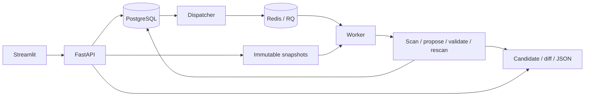

# Architecture and learning map

IaC Guard evolves the verified-remediation workflow of
[llm-iac-security](https://github.com/Shlok014/llm-iac-security). It is a separate
implementation; historical model metrics and authorship claims are not reused.

## Core boundary

`iac_guard.scanners`, `projects`, and `remediation` contain no HTTP, database, Redis,
or AWS clients. Scanner reports retain scanner identity, relative file paths and
duplicate occurrence counts. The same engine is called from the CLI and RQ worker.
Only explicit, unambiguous root-resource booleans have fix handlers. No LLM is used.

Selected variables load after `terraform.tfvars` and lexically ordered auto files.
An isolated scan-only view replaces variable files with one effective assignment file;
every `.tf` file retains its original relative path and bytes. Assignment source spans
preserve maps, lists, strings and heredocs without serializing expressions. This avoids
scanner differences in multi-file precedence. Trivy runs from that view's root with a
root-relative variable path. Original snapshots and downloadable candidates retain
their original variable files. Unselected variable files are neither parsed nor loaded.

Project ZIPs are inspected in memory, not passed to extractall. Original ZIP names are
validated before Windows separator/NUL normalization. Count, compressed/expanded size,
UTF-8, file type, special file, traversal and collision checks precede materialization.
The root-module file set is preserved and every accepted edit passes both full-project
rescans. Resource-address checks do not prove semantic equivalence or deployability.

### External-module constraint

Trivy's `--tf-exclude-downloaded-modules` flag excludes findings; it does **not** disable
downloads. Therefore both-scanner jobs containing remote/dynamic module sources fail
explicitly before either scanner runs. This implements the no-download requirement.
Bundle module source locally to scan it. Checkov-only CLI scans can report partial root
coverage with external downloads disabled. See the
[Trivy explanation](https://trivy.dev/docs/dev/guide/coverage/iac/terraform/#remote-modules).
Missing local modules and unresolved references are disclosed; static scanning does not
resolve provider schemas. No terraform init/validate/plan/apply is run on uploads.

## Durable state and jobs

- `projects` organize reviews. `snapshots` record immutable content hashes, manifests,
  selected variables and content-addressed object keys.
- `jobs` track queued/running/completed/failed outcomes. Completed means tools executed,
  not zero findings. `findings` preserves duplicates; `artifacts` stores download metadata.
- `outbox` is inserted in the same transaction as the job. Redis outages leave pending
  records for later dispatch. PostgreSQL row locks and SKIP LOCKED coordinate dispatchers.
- The worker atomically claims queued jobs with an execution token. Final writes require
  that token and running state; duplicate/stale workers cannot publish duplicate results.
- Reconciliation runs every five seconds. Missing queued Redis records are republished.
  Explicit RQ failures or recovery deadlines turn abandoned jobs into visible failures.
  The running deadline is 35 minutes; the waiting deadline is 24 hours. A retry creates a
  new linked job, preserving the original record. There is no exactly-once claim.
- Source/artifact object writes are content-addressed; failed database transactions can
  leave unreferenced objects. Automatic garbage collection is deferred.

Run one worker initially. Scanner calls time out after 180 seconds; RQ scans have a
10-minute limit and fixes a 30-minute limit. Three patch attempts are permitted per UI
fix job. Redis has append-only persistence; PostgreSQL and local storage use named volumes.

## API and storage

OpenAPI is available at `/docs`. Routes under `/api/v1` create/list projects, submit scans,
list history, retrieve jobs/findings, propose fixes, retry failures and download artifacts.
Submissions return HTTP 202. Invalid uploads return 422 (413 for oversized uploads).
The browser talks only to the API; saved job URLs can be reopened after refresh.

Local storage uses a named volume. AWS uses private SSE-S3 objects through the EC2 role;
no credentials or public signed links are returned to the browser. Infrastructure,
networking, role permissions, service isolation and trusted dependency supply chains
remain part of the operator's responsibility.

## Deployment model

Docker Compose runs a migration job, API, UI, dispatcher, worker, PostgreSQL and Redis.
Only UI/API ports are published, bound to localhost. Application containers run as a
non-root user with dropped capabilities and a read-only root filesystem. They receive
no Docker socket. The worker uses a persistent scanner cache and a bounded temporary
filesystem. Cache cleanup is an operator task.

AWS adds a single EC2 server, VPC, S3, instance role, SSM and CloudWatch. The VM has no
inbound security-group rules. Its public address is for outbound TLS connectivity; no
NAT gateway or load balancer is provisioned. Access is through SSM port forwarding.
This is a private, single-user learning deployment, not a public multi-tenant service.

## Learning checkpoints

1. Explain why scanner crashes and findings-present outcomes must differ.
2. Trace one file from upload through the snapshot, job, scanner and report records.
3. Stop Redis, submit a job, restart Redis and explain how the outbox recovers delivery.
4. Kill a worker and explain token fencing, the recovery deadline and linked retries.
5. Compare two scanners on one labeled case without adding their overlapping totals.
6. Explain IAM credentials, container networking, S3 object storage and cloud teardown.
